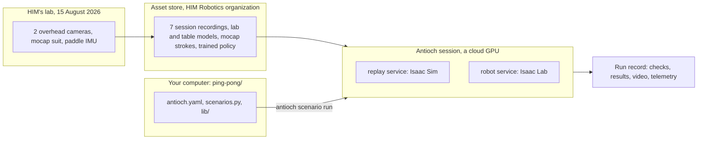

# Ping pong

**A real table-tennis lab rebuilt in simulation, and a humanoid robot that learned to play in it.**

On 15 August 2026, HIM Robotics recorded people playing table tennis in their lab. Two cameras above the table filmed
every rally. They were Orbbec RGB-D cameras, which record colour and the distance to every pixel. One player wore a
Rokoko motion-capture suit, and a motion sensor (an IMU) rode on the paddle. This project turns that recording into
simulations you can run, change and learn from:

- **The lab as a digital twin.** A digital twin is a virtual copy of a real place, accurate enough to compare with the
  real thing. This one has HIM's room, table, net and lighting, and both overhead cameras exactly where they stood.
- **Ball physics checked against reality.** The ball flies, spins and bounces by published physics. It is checked
  against an independent reference model, and the table's bounce is fitted to 1,117 real bounces from the recording.
- **The recorded games, replayed.** Both players move as they really did, but the ball is simulated from the first
  serve, and the virtual cameras' video plays beside the real footage.
- **A humanoid robot that rallies.** A Unitree G1 learned to return the ball. In the recorded evaluation it returned
  0.970 of the balls sent to it legally.
- **A template for your own controller.** The same robot stands at the same table, with nothing controlling it yet.
- **Human strokes moved onto the robot.** The motion-capture strokes are *retargeted* onto the G1's body: translated
  to its shorter limbs, then checked against what its motors can do.

You need a laptop and a terminal, not a GPU. The heavy work runs on Antioch's cloud machines.

> **New here?** Read [What is Antioch?](#what-is-antioch), follow the [quick start](#quick-start), then try
> [your first experiments](#your-first-experiments). Every term is also in the [glossary](#glossary).

## Contents

1. [What is Antioch?](#what-is-antioch) and [how the pieces fit](#how-the-pieces-fit)
2. [Quick start](#quick-start)
3. [The four scenarios](#the-four-scenarios)
4. [Watch it live in Mission Control](#watch-it-live-in-mission-control)
5. [How it works](#how-it-works)
6. [Your first experiments](#your-first-experiments)
7. [Adding your own humanoid](#adding-your-own-humanoid)
8. Reference: [recorded runs](#recorded-runs), [honest limits](#honest-limits),
   [troubleshooting and FAQ](#troubleshooting-and-faq), [glossary](#glossary), [layout](#layout),
   [development](#development)

## What is Antioch?

[Antioch](https://antioch.com) is a cloud platform for robot simulation. Your code stays on your computer, and you
drive everything with one terminal command, `antioch`. That command is a *CLI* (command-line interface). It comes
with the Antioch *SDK* (software development kit), a Python package called `antioch-sim`. When you ask for a run,
Antioch:

1. uploads a snapshot of your project's files;
2. builds the simulator software into a *container image* (a sealed, ready-to-run bundle of software), but only when
   it hasn't built that exact version before;
3. starts a cloud machine with a GPU, called a *session*, and runs your code there;
4. keeps a permanent *run record*: the inputs, which checks passed, the measurements, and the videos and 3D
   recordings (*telemetry*).

The record outlives the machine, so you, your teammates and your future self can study a run long after it ended.

### How the pieces fit

Read this diagram from left to right. HIM's recording became *assets*: versioned files stored in HIM's space on
Antioch. Your code says what to simulate. A run brings the two together on a cloud GPU, and leaves a record behind.



## Quick start

### What you need

- **An Antioch account in the HIM Robotics organization.** An *organization* is a team's shared space on Antioch: its
  runs, its stored files and its compute. This project is locked to HIM Robotics' organization (see
  [the organization lock](#the-cli-refuses-because-of-the-organization)), so ask your HIM contact for an invitation
  first.
- **Access to this repository** on GitHub, and `git`.
- **A terminal.**
- **[uv](https://docs.astral.sh/uv/)**, a Python package manager. If you already have Python, `pip install uv`
  installs it. uv then downloads the Python 3.12 this project needs by itself.

You don't need a GPU, and you don't install Isaac Sim.

### 1. Get the code and the tools

```bash
git clone https://github.com/HIMRobotics/himsimulations.git    # or clone over SSH
cd himsimulations/ping-pong
uv sync --locked --group dev
```

`uv sync` builds a private Python environment in `.venv/` with the exact versions listed in `uv.lock`. That includes
the Antioch SDK and CLI (`antioch-sim` 0.5.338), type hints for Isaac's code so your editor understands it (not Isaac
itself), and a CPU-only PyTorch for the local tests. The first sync is a large download. Put `uv run` in front of a
command to run it inside that environment. Every command in this README runs from `ping-pong/`.

### 2. Look before you run

```bash
uv run antioch scenario collect    # the four scenarios and their cases
uv run antioch suite collect       # the four suites and the runs each one starts
uv run python main.py list         # every case's exact inputs
```

These commands only read `scenarios.py`, `antioch.yaml` and `lib/config.py` on your computer. They upload nothing and
start no machine, so they're free.

You'll see four *scenarios*. A scenario is one kind of experiment, written as a Python function. Each scenario has
*cases*: named sets of inputs. For example, `replay_him_session` has nine cases: one per recorded session
(`session-1` to `session-7`), a short one (`session-2-first-point`), and a deliberately broken one (`nc-dead-table`).

### 3. Sign in

```bash
uv run antioch auth login     # prints a link: open it in your browser and approve
uv run antioch auth whoami    # shows who you are and which organization is active
```

If `whoami` shows an organization other than HIM Robotics, switch to it:

```bash
uv run antioch auth switch    # choose HIM Robotics from the list
```

### 4. First run: the template

Start with the template, because it's the cheapest run:

```bash
uv run antioch scenario run load_humanoid_at_table --cases unitree-g1
```

A Unitree G1 holding a paddle appears at the table. A ball is dropped onto the table to test its bounce, three of
HIM's recorded shots are sent at the robot, and the scene is filmed. The robot only holds its pose, because this is
the starting point for your own controller.

After you press enter:

1. The CLI uploads a snapshot of the project, so the code that runs is your local copy, edits and all.
2. Antioch builds the `robot` service's image if this version hasn't been built before. The first run is the slowest.
3. Antioch starts a session, or reuses an idle one it started for you. A *service* is one of the containers a project
   declares; this session runs the `robot` service on one GPU.
4. The scenario runs and records its checks. The CLI waits for it to finish and prints the result.
5. A session Antioch started for your runs shuts down after five idle minutes.

One execution of one case is a *run*. Its record is permanent.

### 5. See the results

- **In the Antioch web console.** Sign in with the same account. Each run has a page with its checks, its measured
  results, its files (*artifacts*), and a viewer for its telemetry, including the 24 fps film of the robot in the lab
  twin. Teammates can watch a run there while it's still going.
- **Live, in Mission Control.** Add `--stream` to a run to watch the simulator itself while it works, in your
  browser: `uv run antioch scenario run load_humanoid_at_table --cases unitree-g1 --stream`. See
  [Watch it live in Mission Control](#watch-it-live-in-mission-control).
- **In the terminal:**

```bash
uv run antioch scenario list --mine           # your recent runs, newest first, with their run IDs
uv run antioch scenario show <run id>         # one run's checks and results
uv run antioch scenario logs <run id>         # what the run printed
uv run antioch scenario download <run id>     # its files, such as the replay's broadcast.mp4
```

### 6. Next: the replay, then the trained robot

```bash
uv run antioch scenario run replay_him_session --cases session-2-first-point
uv run antioch scenario run play_ping_pong_policy --cases g1-rally-smoke
```

The first plays the opening point of HIM's session 2 in Isaac Sim, with the simulated cameras beside the real ones.
The second gives the trained G1 30 s of rallies in 64 parallel copies of the table. It then plays 30 s more with the
ball hidden from the robot, a test it must fail.

### 7. Run a suite

A *suite* is a named group of runs, declared in `antioch.yaml`. Each one stays on a single simulator:

```bash
uv run antioch suite run robot-smoke     # the trained policy, the template and a 10-stroke retargeting probe
uv run antioch suite run replay-smoke    # session 2's first point, and the dead-table control
```

### How long it takes, and what it uses

While it runs, a run holds one `rtx-pro-6000` GPU (an NVIDIA RTX PRO 6000). The replay also runs a small video encoder
beside it, with 2 CPUs. So a run's GPU time is roughly its wall-clock time. Suites run two at a time unless you pass
`--parallel`, and each scenario stops at a 3-hour limit.

Here's what each run simulates, and how long it took when it was recorded in the HIM Robotics organization
(2026-10-14). Your times will differ a little from machine to machine; `scenario show` tells you exactly what yours took.

| Run | What it simulates | Known costs on top | Measured wall time |
|---|---|---|---|
| `load_humanoid_at_table` `unitree-g1` | 4 copies of the table. A drop test, then 3 feeds, each followed for at most 4 s; at most 20 s in all | Starting Isaac Lab, plus about 4 min compiling the GPU ball physics | 4.2 min |
| `play_ping_pong_policy` `g1-rally-smoke` | 64 copies: 30 s of rallies, then 30 s blind | The same 4 min compile | 35 min |
| `play_ping_pong_policy` `g1-rally` | 2048 copies: 30 s of rallies, then 30 s blind | The same 4 min compile | 31 min |
| `replay_him_session` `session-2-first-point` | One point: 388 frames per camera at 24 fps (about 16 s), the ball stepped 3840 times a second | Starting Isaac Sim; fetching session 2's 314 MB recording | 3.8 min |
| `replay_him_session` `session-2` | All 22 points: 4,254 frames per camera (about 3 min) | As above | 22 min |
| `retarget_him_strokes` `unitree-g1-smoke` | 10 strokes of one rally; no simulator | 4-5 min of solving on one CPU thread | 5.7 min |
| `retarget_him_strokes` `unitree-g1` | All 191 rallies, 737 strokes | About 5 CPU-hours at the smoke case's pace, split over 24 worker processes | not yet measured |

The first run on a new image also waits for the image build, and any run can wait in a queue when machines are busy.

## The four scenarios

`scenarios.py` declares the four scenarios. Each one is a thin wrapper: it takes the case's inputs (a *preset* from
`lib/config.py`) and calls one run function in `lib/`. That function does the work and records its checks.

| Scenario | Engine | Service | Cases | What you see |
|---|---|---|---|---|
| `replay_him_session` | Isaac Sim | `replay` | `session-1` .. `session-7`, `session-2-first-point`, `nc-dead-table` | HIM's games with a live ball, simulated and real cameras side by side |
| `play_ping_pong_policy` | Isaac Lab | `robot` | `g1-rally-smoke` (64 copies), `g1-rally` (2048) | The trained G1 rallying against HIM's opponent |
| `load_humanoid_at_table` | Isaac Lab | `robot` | `unitree-g1` | A G1 at the table holding its pose while balls come at it |
| `retarget_him_strokes` | none (CPU) | `robot` | `unitree-g1-smoke` (10 strokes), `unitree-g1` (all) | Human strokes played back on a stick-figure G1, each marked kept or rejected |

### `replay_him_session`: the recorded games, with a live ball

The players' motion comes from the recording. The suited player's comes from the mocap suit; the opponent's is
inferred from the overhead video. The ball doesn't come from the recording: from the first serve it flies by the
calibrated physics. When the simulated ball goes somewhere slightly different from the real one, each player *bends*
their recorded stroke to meet it. The bend is a small time shift and a nudge and tilt of the paddle, kept within what a
human could do. The virtual overhead cameras render beside HIM's real camera frames, 24 frames a second, so you can
compare any moment of the replay with the real game.

Read this sketch from top to bottom, as the order things happen in. It's `lib/replay/run.py` with the error handling
left out:

```python
def replay_him_session(run, params):  # lib/replay/run.py
    session = load_him_session(params)  # mocap, serves, strokes, camera epochs, real frames
    physics = engine_physics(params)  # the calibrated priors, or the negative control's dead table
    build_him_lab(stage, physics)  # room, table, net, colliders, calibrated lighting
    cameras = author_him_cameras(stage, camera_calibrations(session))
    aim_viewport(BROADCAST)  # where a stream to Mission Control starts
    ball = attach_live_ball(world, stage, physics, roles)  # hybrid contacts, calibrated impact law, RK4 at 3840 Hz
    players = spawn_players(stage, session)  # the recorded player and the inferred opponent
    recorder = open_recorder(run, params, cameras, session, physics)  # simulated beside real at 24 fps, and the MP4
    replay = ReplayLoop(run, session, nominal_params(), ball.physics, players.bodies, players.animators, recorder, ...)
    replay.drop_tests()  # ITTF 30 cm drops
    replay.play()  # every point, until the last ends physically
    return grade(run, params, session, replay)  # motion QA, physical invariants, telemetry, terminal
```

On every rendered frame, a referee reads the ball's contacts and applies the rules of a point. Each player is posed
from the recording. If a stroke is due soon, it's planned from the ball's predicted flight, and the arm reaches to put
the paddle on the plan. When a simulated point ends before the real one did, the next recorded stroke is played with a
labelled **continuity ball**. Continuity balls are never counted as evidence.

The replay passes when it reaches its natural end (the last point finishes physically) and all three of its tests pass:

- **Motion QA.** No broken pose, no frame outside the recorded track, at most one glitch per minute, and the paddle
  stays in the hand (within 1 cm on every frame).
- **Physical invariants.** The ball never passes through anything (*tunnelling*) or leaves the room, no bounce gains
  energy, no point has more than four net touches, and the opening drop tests land in the ITTF band of 23-26 cm.
- **Telemetry completeness.** Every rendered frame of every camera at 24 fps, every recorded Orbbec frame at its own
  time, 3D telemetry 12 times a second, and an MP4 with every frame.

How many recorded strokes the simulation turns into real paddle contacts is reported, not graded. A live ball drifts
away from the recorded one, so some strokes miss.

### `play_ping_pong_policy`: the trained robot

The trained G1 plays against a model of HIM's opponent, learnt from the recordings. Thousands of copies of the table
(*environments*, or *envs*) run side by side on one GPU, each with its own robot, ball and opponent. Env 0 is filmed
in the lab twin at 24 fps.

Each run has two passes. First the policy plays 30 s of rallies. Then the same robot plays 30 s with the ball and its
forecast hidden from it: the *blind control*. A robot that really plays from the ball must collapse when it can't see
it.

Read this sketch as the run's two passes, then the grade. It's a simplified `lib/policy/run.py`:

```python
def play_ping_pong_policy(run, params):  # lib/policy/run.py
    rally = CoupledRally(seed=params.seed)  # the HIM opponent, its opening feeds, the ball forecast
    scene = build_table_scene(robot, params.num_envs, hooks=rally, opponent=True)  # the G1 at the table in every env
    actor = load_rally_actor(params.policy)  # the trained network, from the asset store
    played = rally.play(scene, actor, params.max_sim_s)  # 30 s of rallies; env 0 filmed at 24 fps
    blind = rally.play(scene, hide_ball(actor), params.control_s)  # the ball hidden: must collapse
    return grade(run, played, blind)  # legal returns per receive, falls, and the run's checks
```

The headline number is **legal returns per receive**. A *receive* is a ball the opponent sends toward the robot's half
of the table. A *legal return* is a hit whose first bounce lands on the opponent's half. The run's checks test the
harness, not the robot: the blind control collapses (at most 0.02 legal returns per receive), the physics engine's
GPU memory never overflows, both passes run their full 30 s, and the film has every frame. The policy's own numbers
are reported, never graded. [`docs/policy.md`](docs/policy.md) covers it in depth.

### `load_humanoid_at_table`: your starting point

This is the same scene with no brain. In each env it puts the robot at the table, then:

1. drops a ball 30 cm onto the table and measures the rebound (the ITTF test for a table);
2. sends HIM's recorded feeds at the robot, one after another;
3. steps the robot with zero actions, which hold its ready stance, until each ball stops or leaves the table.

The robot's pelvis is pinned in place (`fixed_base=True`), because a G1 with no balance controller would fall over.

Read this sketch as one loop per ball. The marked line is where your controller goes. It's a simplified
`lib/robots/template.py`:

```python
def load_humanoid_at_table(run, params):  # lib/robots/template.py
    scene = build_table_scene(ROBOTS[params.robot], params.num_envs, fixed_base=params.fixed_base)
    for ball in launch_balls(scene, watch, params.balls):  # the 30 cm drop test, then HIM's recorded feeds
        while ball.in_play():
            scene.step(actions=scene.hold_default_pose())  # <- replace with your controller
    return check_scene(run, scene)  # drop rebound in the ITTF band, nothing non-finite, PhysX healthy, film complete
```

It passes when the scene's 3D models match their pinned versions, the drop rebounds 23-26 cm in every env, nothing goes
non-finite (NaN or infinite), the physics engine's GPU memory never overflows, the film has every frame, and every
ball ends before the time limit.

### `retarget_him_strokes`: human strokes on a robot body

This takes HIM's motion-captured strokes and finds G1 joint motions that move the paddle the way the human did. Then it
checks each stroke against what the G1 can really do. No simulator starts, because this is pure maths on the CPU. The
kept strokes are published to the asset store as `ping-pong/unitree-g1-retargeted-strokes`, with the first 8
characters of the run ID as the version.

Read this sketch as four steps, from human motion to a package of robot motion. It's the core of
`lib/retarget/run.py`:

```python
human = load_mocap_strokes(asset)  # HIM's strokes on the table frame, the paddle state at each contact
robot = robot_model(ROBOTS["unitree-g1"])  # URDF kinematics, joint limits, motors, the paddle on the wrist
rallies = retarget(human, robot)  # reach -> targets -> whole-rally IK -> quality checks, per rally
package = write_package(kept_clips(rallies))  # the kept motion and every stroke's check values
```

Each stroke is checked for **reach** (the paddle follows the human's path within 1 cm and 5°), **speed**, **torque**,
**balance** and **feet** (no sliding, no sinking into the floor). [`docs/retargeting.md`](docs/retargeting.md) has
the details.

## Watch it live in Mission Control

A run's record is for studying afterwards. **Mission Control** is for watching a run while it happens. It's the part
of Antioch's web console that shows the simulator's own 3D window live, streamed from the cloud GPU to your browser as
video: the robot, the ball and the lab, moving as the simulation computes them.

### Stream a run

A run streams only when you ask. Add `--stream` to the command:

```bash
uv run antioch scenario run replay_him_session --cases session-2-first-point --stream
uv run antioch scenario run load_humanoid_at_table --cases unitree-g1 --stream
uv run antioch scenario run play_ping_pong_policy --cases g1-rally-smoke --stream
uv run antioch suite run replay-smoke --stream    # every run in the suite streams
```

> **Streamed, the robot scenarios film one camera.** `load_humanoid_at_table` and `play_ping_pong_policy` normally
> record two videos of env 0: the side view (`camera`) and HIM's overhead Orbbec 8F view (`camera_8f`). Streamed, they
> record the side view only, because with the 8F camera attached as well a streamed Isaac Lab run hangs. That's a
> fault in Antioch's streamed Isaac Lab runs, and it's been reported. Run without `--stream` when you want the 8F
> view. The checks are the same either way: the film check grades the side view.

Then open the Antioch web console, signed in with the same account, and find the run in Mission Control while it's
running. The CLI doesn't print a link to the stream. It does keep a note of it: `uv run antioch scenario show
<run id> --json` shows `"livestream": true` for a streamed run.

Good to know:

- **Watching changes nothing.** A streamed run simulates exactly what an unstreamed one does, and passes or fails the
  same checks. (Streamed, the first point of session 2 played the same strokes, the same 33 ball contacts and the same
  drop-test rebounds, to the 0.1 mm, as the unstreamed record.)
- **One viewer at a time.** The simulator streams to one browser at once. If a teammate is already watching, you wait
  until they close it.
- **It isn't real time.** You see the simulation at the speed the GPU computes it, which is slower than real life.
  Streamed, the replay runs about 8 times slower, so session 2's 16 s first point takes over two minutes to watch. The
  recorded videos play at true speed.
- **Starting up takes a while.** The picture appears once the simulator has started, within a minute of the run
  starting. The robot scenarios then spend about four minutes compiling the GPU ball physics, and the picture can
  stand still meanwhile.

### What you'll see

| Scenario | In Mission Control |
|---|---|
| `replay_him_session` | The HIM lab from the broadcast camera's spot, high up behind the 8F end of the table: both players head to foot, and the live ball. Fly anywhere you like: you move only the stream's own camera, never a camera the run records |
| `load_humanoid_at_table` | Once the ball physics has compiled, the HIM lab twin around env 0, seen from the side (the `cine_wide` camera): the G1, the drop test and the three feeds. This is the run's film itself, so the other three envs are hidden |
| `play_ping_pong_policy` | The same view: env 0 rallying against the opponent's red paddle. The other envs (63, or 2047) are hidden but still playing. After the 30 s policy pass the film stops, and the blind control plays on in the same view with no ball drawn |
| `retarget_him_strokes` | Nothing: it's maths on the CPU, with no simulator and no 3D window to stream. Its telemetry plays the strokes back once they're solved |

### Looking around

In the replay, fly the camera from the keyboard. If the keys do nothing, click on the picture first:

| Keys | What they do |
|---|---|
| Arrow keys | Move forward, back and sideways |
| Shift + arrow keys | Turn, and look up or down |
| Ctrl + Up or Down | Rise or sink |
| `-` and `=` | Slow down or speed up, by 1.5 times a press; hold X to double the speed, or Z to halve it |

Isaac's own mouse controls work too: hold the right button and drag to look around (W, A, S and D fly while you hold
it), Alt + left-drag to orbit, middle-drag to pan, and scroll to zoom. F7 shows or hides Isaac's menus and panels.

In the template and the policy, the view is the film's camera, and it's locked: you watch exactly what's being
recorded. If you could fly that camera, the film would fly with it, and could lose the frames it was capturing as it
moved, which would fail the run's film check.

### Stream while you work interactively

In a session you started yourself, `service exec` streams one command, and `service shell --stream` opens a
terminal whose simulator commands stream:

```bash
uv run antioch session new --profile robot
uv run antioch service exec --service robot --stream -- python main.py template unitree-g1
```

The notebook starts Isaac Lab without a stream. To watch it, open `demo.ipynb` in JupyterLab as usual (see
[experiment 5](#5-plug-in-your-own-controller)), then, before you run its first code cell, start Isaac Lab in the
notebook's kernel from a second terminal, with `--stream`:

```bash
uv run antioch jupyter cell --stream "import antioch; from lib.config import ROBOT_SIMULATION_CONFIG; antioch.start_simulation(ROBOT_SIMULATION_CONFIG)"
```

`jupyter cell` runs its code in the session's kernel, which is the notebook's while it's the only one open. The
notebook's own `start_simulation` then finds Isaac Lab already running and carries on. The notebook draws the plain
scene, without the lab twin: the envs side by side on a grid floor, which you can fly around.

### What it costs

- **Time, in the replay.** Streamed, the simulator also draws its window, the whole lab, for every frame. The
  streamed first point of session 2 took 6.5 min instead of 3.8 min.
- **Little or none, in the robot scenarios.** They draw that window for their film anyway. Three streamed template
  runs took 4.2, 4.3 and 5.8 min, against 4.1 and 6.0 min unstreamed; most of the spread is the GPU compile, which
  varies from machine to machine. The streamed policy smoke run took 36.2 min, against 35.2 min unstreamed.
- **Nothing else.** A streamed run holds the same one GPU, and counts against your quota the same way.
- **Picture size.** Each run's `renderer_quality` (in `lib/config.py`) caps the stream's picture: `performance` at
  1920 × 1088, `balanced` at 2560 × 1440 (the robot scenarios) and `quality` at 3840 × 2176 (the replay). Mission
  Control fits the picture to your browser window within that cap. Leave the replay's alone: it also sets how the
  virtual Orbbec cameras render, and the replay compares their frames with HIM's real ones.

### Live stream or recording?

| | Mission Control | The run's record |
|---|---|---|
| When | Only while the run goes | Forever |
| What | The simulator's window, live | Checks, results, the 24 fps films and `broadcast.mp4`, and 3D telemetry |
| Speed | As fast as the GPU simulates | Plays at true speed, and you can scrub back and forth |
| Camera | Yours to fly, in the replay | The run's fixed cameras |
| Who | One viewer at a time | Everyone in the organization |
| Needs | `--stream` | Nothing: every run records |

Nothing from the stream is saved. To keep a view, use the run's recorded films and telemetry.

## How it works

### Antioch's building blocks, in this project

- **Project.** This `ping-pong/` directory. Antioch knows it by the `id` in `antioch.yaml`.
- **Manifest.** `antioch.yaml`, the file that describes the project to Antioch. Here's a trimmed copy with comments:

```yaml
id: ping-pong-40009da473c0444188ac40f9ce5a8c48  # the project's permanent identity
organization_id: org_R94gKeCzTxrpN61i           # HIM Robotics: remote commands refuse in any other organization
scenario_paths: ["scenarios.py"]                 # where the scenarios are declared
services:
  replay:      # Isaac Sim 6.0.1, built from Dockerfile, one GPU; profile "replay"
  compositor:  # the replay's MP4 encoder, 2 CPUs; profile "replay"
  robot:       # Isaac Lab 3.0, built from robot.Dockerfile, one GPU; profile "robot"
suites:
  replay-smoke:     # replay_him_session: session-2-first-point and nc-dead-table
  robot-smoke:      # the policy, the template and the retargeting probe
  replay-evidence:  # replay_him_session: session-2
  robot-evidence:   # play_ping_pong_policy: g1-rally
```

- **Services and profiles.** A service is a container the project can run, and a *profile* is a named group of
  services started together. The `replay` profile starts `replay` and `compositor`; the `robot` profile starts
  `robot`. So a session only ever starts one simulator. Each scenario names its service in `scenarios.py`.
- **Images and source sync.** Each engine service is built from a Dockerfile that starts from Antioch's engine image
  (`antioch-engine/isaac-sim-6.0.1` or `antioch-engine/isaac-lab-3.0`). Your code isn't built into the image. It's
  copied into `/workspace/project` on the machine before each command (the manifest's `sync` mapping), so editing
  Python never needs a rebuild.
- **Scenarios, cases and presets.** `scenarios.py` marks each scenario with `@antioch.scenario`. Each case is a
  *preset*: a frozen set of inputs in `lib/config.py`, named the same as the case. Inside the run, the code records
  checks (`run.check`), results (`run.add_results`), files (`run.add_artifact`) and telemetry (`antioch.Logger`).
- **Suites.** Named groups of scenario cases in `antioch.yaml`. *Smoke* suites are quick checks that everything works;
  *evidence* suites are the bigger runs whose numbers are quoted in [recorded runs](#recorded-runs).
- **Runs.** One execution of one case. Its outcome is `passed`, `failed`, `errored`, `timeout`, `cancelled` or
  `skipped`. A run whose checks fail is `failed`; one that crashes is `errored`.
- **Sessions.** Temporary cloud machines running one profile of the project. Antioch starts them for your runs. You
  can also start one yourself (`antioch session new --profile robot`) to work interactively, for example in the
  notebook. Sessions count against your personal and organization quotas until they stop.
- **Assets and the asset store.** Large files live in HIM's asset store on Antioch, never in git: the recordings, the
  3D models, the policy. Each asset has a name and an immutable version, such as `ping-pong/him-session-2@v8`.
  `lib/assets.py` pins every version with its sha256 fingerprint, and runs fetch them with `antioch.fetch_asset`.
  [`docs/assets.md`](docs/assets.md) lists them all.
- **Organizations.** The team that owns the runs, assets and compute: HIM Robotics. Everyone in it can see the runs
  you make.

### Two engines: Isaac Sim and Isaac Lab

Both come from NVIDIA, and both use PhysX, NVIDIA's physics engine. They're good at different jobs, so this project
uses each where it fits.

- **Isaac Sim** (6.0.1) simulates and renders one detailed world. Its RTX renderer traces light rays, so the
  virtual Orbbec cameras produce images you can put next to HIM's real frames. The replay needs exactly that: one
  world, rendered like the real cameras, with very precise contacts. The ball is stepped 3840 times a second, 160
  steps per video frame.
- **Isaac Lab** (3.0) is a robot-learning framework built on Isaac Sim. It runs thousands of copies of a scene on
  one GPU at once, stepping them all together. Training and grading a policy needs exactly that: in the evidence
  run, 2048 copies played 31,784 receives in 30 s of simulated time. Here PhysX runs at 200 steps a second, the
  policy acts 50 times a second, and the ball takes 1 ms sub-steps.

Both engines fly the same calibrated ball, so the replay and the robot live in the same physics.

### What "calibrated physics" means

A table-tennis ball is light (2.7 g) and spins fast, so default physics-engine settings get it wrong. In flight,
gravity pulls it down, air *drag* slows it, and the *Magnus effect* curves it: topspin makes it dip, backspin makes it
float. The spin itself slowly decays. At a bounce, *restitution* sets how much speed it keeps (0 is dead, 1 is
perfectly bouncy), and *friction* sets how much grip the surface has. The paddle's rubber is special: it grips and
springs back, which is what lets a player add spin.

"Calibrated" means every one of those numbers comes from a measurement, and the result is checked against reality:

1. **Every parameter has a source.** `lib/physics/data/priors.json` gives each one a value, a plausible range and a
   citation: ball mass, drag coefficient, rubber restitution, and so on.
2. **The table is fitted to HIM's own data.** Its restitution, 0.94, was set from 1,117 bounces in HIM's recordings.
3. **An independent reference model checks the engines.** `lib/physics/reference/` is the same physics written in
   plain numpy, the *oracle*. Isaac Sim's ball and the GPU ball are both checked against it, within fractions of a
   millimetre.
4. **Every run repeats the official test.** The ITTF (the International Table Tennis Federation) says a ball dropped
   from 30 cm must bounce back 23-26 cm. The replay and the template both start with that drop test.

No physics engine models the rubber's grip and spring natively. So this project computes the ball's contacts itself,
with the reference model's laws, and hands the engine only what it does well. [`docs/physics.md`](docs/physics.md)
has the equations, the parameters and every check.

### Policies and reinforcement learning

A **policy** is the robot's brain, written as a function: it reads an *observation* (numbers describing the robot and
the ball) and outputs an *action* (what to do with each joint), over and over. This one does that 50 times a second.
It reads 146 numbers, such as joint angles, the paddle's position and velocity, and where the ball is and will be. It
outputs 29 numbers, one target angle per joint, which the joints' motors then drive toward. The policy is a small
neural network: three layers of 512, 256 and 128 neurons.

**Reinforcement learning** (RL) is how such a network learns by trial and error. The robot plays, a *reward* function
scores what happened, and the training algorithm adjusts the network to make high-scoring actions more likely. Running
thousands of envs in parallel makes millions of tries affordable. This policy was trained with PPO (proximal policy
optimization, a standard RL algorithm), using the rsl_rl library, in three stages:

1. imitating HIM's strokes, retargeted onto the G1;
2. hitting the ball at commanded contact points;
3. rallying against the HIM opponent from the ball alone. The reward paid most for returns that land legally.

The training code isn't in this repository. The finished network is, as the asset
`ping-pong/g1-rally-policy@e0e0bb45-it1500` (iteration 1500 of training). [`docs/policy.md`](docs/policy.md)
explains exactly what it reads and does, and lists the pieces a training loop of your own would need.

### Motion capture and retargeting

**Motion capture** (mocap) records how a person moves. HIM's player wore a Rokoko suit of motion sensors, which
tracked their joints 30 times a second through seven sessions and 737 paddle contacts.

**Retargeting** moves that motion onto a different body. It isn't a copy: the G1's arm is 0.75 the length of the
human's and its legs 0.84, its joints bend differently, and its motors have limits. So the retargeter solves for joint
angles that put the robot's paddle where the human's paddle was at each contact. This is *inverse kinematics* (IK):
working backwards from where the hand must be to the joint angles that put it there. It then checks every stroke for
reach, joint speed, motor torque, balance and foot slip. A stroke the G1 physically couldn't make is rejected, never
faked. Of the 737 strokes, the reference output keeps 251.

### Checks, negative controls and tests

A **check** is a pass/fail test that a run records about itself, like "the drop rebound is in the ITTF band". Checks
only mean something if they can fail. A **negative control** is a deliberately broken version of a run that *must*
fail. If it passed, the check would be proven blind. This project has three:

- **The dead table** (`replay_him_session` case `nc-dead-table`). The table's restitution drops from 0.94 to 0.30, so
  the ball should barely bounce. Its drop tests rebounded 26.5 mm, failing the 23-26 cm band, so the run passes by
  failing its tests.
- **The blind control** (inside every `play_ping_pong_policy` run). The ball is hidden from the policy, which scored
  0.000 legal returns per receive. That proves the robot really plays from the ball.
- **The raw paddle** (inside every `retarget_him_strokes` run). Strokes graded against the mocap suit's rough paddle
  estimate must fail the paddle-path check. In the smoke run, 10 of 10 failed.

The **tests** in `tests/` run on your computer with `uv run pytest`, CPU only: no simulator, no GPU, no cloud. They
check the ball physics, play session 2's first point on a stand-in engine, check the policy's network and the
opponent, and corrupt a retargeted stroke four ways to show each corruption is rejected. `tests/test_contract.py`
keeps the project's shape: the organization lock, the four scenarios and four suites, the pinned engine images and
assets. They exist so mistakes are caught for free on your laptop, before they cost GPU time.

## Your first experiments

Each experiment changes one or two files, then runs one command. Your edits travel with the run, because the CLI
uploads your project when you submit. After any edit, run `uv run antioch scenario collect` to check the project
still loads before you spend GPU time.

Presets are frozen, so add a new one rather than changing an existing case. That way the recorded cases keep their
meaning. A new preset in `lib/config.py` becomes a new case automatically, named after its key.

### Warm-up (free): spin a ball on your laptop

The reference ball model runs on your own computer. Start `uv run python` in `ping-pong/` and paste:

```python
from lib.physics.params import nominal_params
from lib.physics.reference.simulate import simulate
from lib.robots.template import RECORDED_FEEDS

params = nominal_params()
for spin_y in (0.0, -200.0, 200.0):  # none, topspin, backspin, rad/s
    state = list(RECORDED_FEEDS[0])
    state[7] = spin_y
    bounce = simulate(state, params, max_time=2.0).events_of("table")[0]
    x, speed = bounce.state_before[0], -bounce.state_after[3]
    print(f"spin {spin_y:+5.0f} rad/s: bounces at x = {x:+.2f} m, leaves the table at {speed:.1f} m/s toward the robot")
```

A ball's state is 9 numbers in the *table frame*: position (x, y, z) in m, velocity in m/s, and spin in rad/s. The
origin is the centre of the table top, z points up, and the robot stands at the −x end. These feeds travel toward −x,
so a negative y spin (`state[7]`) is topspin. Compare where each ball bounces and how fast it kicks off the table.

### 1. Put spin on the template's feeds

**File:** `lib/robots/template.py`, `RECORDED_FEEDS`. Add two spinning copies of the first feed at the end:

```python
RECORDED_FEEDS: tuple[tuple[float, ...], ...] = (
    (0.6308, 0.3601, 0.2228, -4.269, -0.0503, 1.3366, 0.0, 0.0, 0.0),
    (0.6233, 0.1676, 0.1684, -4.4368, -1.5753, 1.525, 0.0, 0.0, 0.0),
    (0.8011, 0.0678, 0.178, -5.3711, -0.4361, 1.0831, 0.0, 0.0, 0.0),
    (0.6308, 0.3601, 0.2228, -4.269, -0.0503, 1.3366, 0.0, -200.0, 0.0),  # the first feed with topspin
    (0.6308, 0.3601, 0.2228, -4.269, -0.0503, 1.3366, 0.0, 200.0, 0.0),  # and with backspin
)
```

**File:** `lib/config.py`, `TEMPLATE_PRESETS`. Add a case that launches six balls (the drop, then all five feeds), with
more time:

```python
TEMPLATE_PRESETS: dict[str, TemplateParams] = {
    "unitree-g1": TemplateParams(),
    "unitree-g1-spin": TemplateParams(balls=6, max_sim_s=40.0),
}
```

```bash
uv run antioch scenario run load_humanoid_at_table --cases unitree-g1-spin
```

Watch the film: the topspin ball dips early and shoots off the table, and the backspin ball floats long.

### 2. Unpin the robot

**File:** `lib/config.py`, `TEMPLATE_PRESETS`. Add:

```python
    "unitree-g1-unpinned": TemplateParams(fixed_base=False),
```

```bash
uv run antioch scenario run load_humanoid_at_table --cases unitree-g1-unpinned
```

With zero actions, the robot only holds its joints stiff, and nothing keeps it balanced. Expect it to topple. Each
fall resets it to its stance, and the run's `falls` result counts them. Balance is the first job of any controller
you write.

### 3. Replay a different session

No edits needed: there's a case for each of the seven sessions.

```bash
uv run antioch scenario run replay_him_session --cases session-5
```

Whole sessions are long: from 192.9 s (session 2) to 318.9 s (session 3) of play, listed in `SESSION_DURATIONS_S` in
`lib/config.py`. For a cheaper look, add a first-point case to `REPLAY_PRESETS` in `lib/config.py`:

```python
    "session-5-first-point": ReplayParams(session=5, points=1, max_sim_s=60.0),
```

and run it with `--cases session-5-first-point`. Raise `points` to play more of the session.

### 4. Retarget a different rally

**File:** `lib/config.py`, `RETARGET_PRESETS`. The smoke case solves session 1's rally `s1_r001`. Session 2's first
rally, `s2_r000`, has 10 strokes too:

```python
    "unitree-g1-s2-r000": RetargetParams(sessions=(2,), rallies=("s2_r000",)),
```

```bash
uv run antioch scenario run retarget_him_strokes --cases unitree-g1-s2-r000
```

Then fetch its files with `uv run antioch scenario download <run id>`. The package zip holds `strokes.csv`, whose
`cause` column says why each rejected stroke failed. This run also publishes its kept strokes to HIM's asset store.

To list the rallies yourself, download the mocap bundle (33 MB) into `outputs/`, which git and Antioch both ignore:

```bash
mkdir -p outputs
uv run antioch asset pull ping-pong/him-mocap-strokes -v v1 -o outputs/
```

Then start `uv run python` and paste (the file name is the one `lib/assets.py` lists):

```python
from lib.retarget.source import load_mocap_strokes
from lib.retarget.targets import segments

human = load_mocap_strokes("outputs/him-mocap-strokes-v1.zip", sessions=(2,))
for rally in segments(human.sessions[2]):
    print(len(rally.strokes), "strokes:", [stroke.id for stroke in rally.strokes])
```

### 5. Plug in your own controller

**File:** `lib/robots/template.py`, in `load_humanoid_at_table`. Find this line:

```python
scene.step(actions=scene.hold_default_pose())  # <- replace with your controller
```

An action is one number per joint, in the order of `scene.joint_names`. Each joint's target angle is
`default_pose + action_scale * action`, and its motor drives it there. Zeros hold the ready stance. The scale is a
quarter of the joint's peak torque over its stiffness: 0.156 rad for the G1's arm joints. To swing the paddle arm,
add `import math` at the top of the file, and replace the line with:

```python
actions = scene.hold_default_pose()  # zeros: hold the ready stance
swing = scene.joint_names.index("right_shoulder_pitch_joint")
actions[:, swing] = 3.0 * math.sin(2.0 * math.pi * steps * scene.step_dt)  # about 0.5 rad either way, once a second
scene.step(actions=actions)
```

Then run the `unitree-g1` case again. `scene.step` returns the next observation: one row per env, 116 numbers for the
G1. `observation_terms` in `lib/robots/table_scene.py` lists the columns in order. For example, columns 109-111 are
the ball's position relative to the pelvis, which is where a real controller would start.

For quicker iteration, use the notebook instead. Start a session and open JupyterLab in it, and keep that command
running while you work:

```bash
uv run antioch session new --profile robot
uv run antioch jupyter lab
```

Then open `demo.ipynb`. It builds the same scene and lets you step it cell by cell, with `my_controller` ready to
edit. When you're done, stop JupyterLab and release the session, so it stops using the quota:

```bash
uv run antioch jupyter stop
uv run antioch session release
```

## Adding your own humanoid

Every robot-specific fact lives in one object, a `RobotSpec` (`lib/robots/spec.py`). It describes the robot's body,
joints, motors, stance and paddle as plain data. The table scene, the template, the film and the retargeter read
everything from it, so a new humanoid needs no other code changes. `lib/robots/unitree_g1.py` is the G1's, and it's
the one to copy. In plain words, a spec says:

| Field | What it is |
|---|---|
| `usd`, `urdf`, `urdf_sha256` | The robot's 3D model (USD, the format Isaac reads) and its URDF (the standard robot description of links and joints), with the same joint and link names, and the URDF's sha256 |
| `prune` | Name fragments of the parts the paddle replaces, such as a hand |
| `joint_names`, `actuators` | The joints, and the motor driving each: peak torque, speed limits, rotor inertia, and its PD gains (how stiffly and with how much damping it holds a target) |
| `action_fraction` | How much of a joint's torque one unit of action asks for (the G1 uses a quarter) |
| `default_pose`, `base_height_m`, `stance_m` | The ready stance, the pelvis height in it, and how far behind the table the robot starts |
| `paddle` | Which wrist link holds the paddle, how far along it the blade centre sits, and the paddle's mass |
| `links`, `fall` | The pelvis, torso, feet and paddle arm by name, and when the robot counts as fallen |
| `colliders` | Collision shapes for links the USD leaves without one, so the whole body can touch the table |
| `retarget` | Optional: what the stroke retargeter needs, such as sole corners and coarse collision spheres |

To add one:

1. Write `lib/robots/<your_robot>.py` with its `RobotSpec`, following `unitree_g1.py`. Its `usd` can be a path, with
   `{ISAAC_NUCLEUS_DIR}` standing for NVIDIA's asset library.
2. Register it in `ROBOTS` in `lib/robots/__init__.py`.
3. In `lib/config.py`, add its name to `RobotName`, and add a preset such as
   `"my-robot": TemplateParams(robot="my-robot")` to `TEMPLATE_PRESETS`.
4. Check it loads with `uv run antioch scenario collect`, then run
   `uv run antioch scenario run load_humanoid_at_table --cases my-robot`.

The table scene refuses to build if the robot's joints don't match `joint_names`, or a name points at a missing part,
so mistakes show up early. The retargeter works for any spec with `retarget` set
([`docs/retargeting.md`](docs/retargeting.md) lists exactly what it needs). The trained policy doesn't: it was trained
on the G1's exact joints and motors, so a new robot needs a policy of its own, and the template is where that starts.

## Recorded runs

These are the four suites and what passing each one means:

| Suite | Engine | Runs | What passing means |
|---|---|---|---|
| `replay-smoke` | Isaac Sim | `replay_him_session[session-2-first-point]`, `[nc-dead-table]` | The first point passes every replay test; the dead table (restitution 0.30) fails its drop tests, as a negative control must |
| `robot-smoke` | Isaac Lab | `play_ping_pong_policy[g1-rally-smoke]`, `load_humanoid_at_table[unitree-g1]`, `retarget_him_strokes[unitree-g1-smoke]` | The policy rallies and its blind control collapses; the template scene is sound; the probe rally retargets |
| `replay-evidence` | Isaac Sim | `replay_him_session[session-2]` | All of session 2 passes every replay test |
| `robot-evidence` | Isaac Lab | `play_ping_pong_policy[g1-rally]` | The policy at 2048 worlds, 30 s, against the opponent |

Recorded on Antioch production in the HIM Robotics organization, 2026-10-14. If you're in the organization, read any
of them with `uv run antioch scenario show <run id>`:

| Run | Result | Record |
|---|---|---|
| `replay-smoke` | Passed. First point: every test passes, drop rebounds 252.2–253.7 mm, 8 of 18 recorded strokes realised, 388/388 frames on every camera. Dead table: drops of 26.5 mm fail the physical invariants, as designed | `a386a0e271dc43b2a8821652c47666ac`, `e2d00a7f0b3146009fce89d621b0a50d` |
| `robot-smoke` | Passed. Policy: 0.978 legal returns per receive over 986, no falls, blind control 0.000. Template: drop rebound 252.2 mm. Retarget: 5 of 10 probe strokes kept, negative control 10 of 10 rejected | `cae1406efcee4f2e864ccaa62196e8db`, `75fc279aca714122b38b64118d0af473`, `bdd3e07ec3764d7187ce5e47f01858ac` |
| `replay-evidence` | Passed. All 22 points of session 2; 0 of 209 contacts gained energy; 4254/4254 frames per camera; 53 of 122 recorded strokes realised | `55e9e72446bd4de1a7e1601a55e7ec04` |
| `robot-evidence` | Passed. 0.970 legal returns per receive (95 % interval 0.968–0.972) over 31,784 receives, 0.0015 falls per 10 s, mean rally 8.1 legal shots, blind control 0.000 | `fc36a10fdd804624a45c7a83fe3b545e` |

The robot runs were recorded before the opponent's code was slimmed down. `tests/robot/test_opponent_identity.py`
shows the slimmed opponent plays every shot bit-identically.

## Honest limits

**What's been checked:**

- the ball physics, against an independent reference model and HIM's recorded bounces;
- the replay of all of session 2, which passes every test;
- the policy, in simulation, against a model of HIM's opponent.

**What hasn't:**

- **No real robot has run this policy.** It's a simulation result.
- **The policy reads perfect information.** It gets the ball's exact position, velocity and spin, plus a physics
  forecast of its flight. A real robot would have to estimate those from cameras, with errors and delays.
- **The G1's motors are taken from Unitree's published specifications** and deployed settings, not measured on a real
  G1.
- **The opponent is a model** learnt from HIM's recordings, not a person.
- **The policy has weak spots.** It fails on heavy backspin, and returns at most half the balls that arrive at 11 m/s
  or faster, at any spin.
- **The replay realises only part of the recorded strokes.** In session 2, 53 of 122 recorded strokes became real
  contacts in simulation. The rest missed, or were played with continuity balls. This is reported, not graded.
- **Retargeting checks are rigid-body maths, not a full simulation.** A stroke that passes them still needs a
  controller that can track it in physics.
- **Some things aren't modelled:** wind, the net sagging, and a ball deforming beyond the measured bounce curves.

## Troubleshooting and FAQ

### The CLI refuses because of the organization

`antioch.yaml` sets `organization_id: org_R94gKeCzTxrpN61i`, which is HIM Robotics. Remote commands, such as runs,
sessions and asset pushes, refuse unless that organization is active, so nothing can land in the wrong team's space.
Check and fix it:

```bash
uv run antioch auth whoami    # which organization is active?
uv run antioch auth switch    # choose HIM Robotics
```

If HIM Robotics isn't in the list, your account hasn't been invited yet: ask your HIM contact. Meanwhile, everything
local still works: `collect`, the tests, and the reference ball model.

### Sessions and quotas

A session is a cloud machine, and it uses your organization's compute while it's up. Sessions count against your
personal quota and the organization's total until they stop.

- Sessions Antioch starts for your runs shut down five idle minutes after their last run.
- Sessions you start yourself (`session new`) shut down after fifteen idle minutes, unless you change that with
  `--idle-timeout`.
- `uv run antioch session list` shows your sessions; `uv run antioch session release` stops one now. Run
  `uv run antioch jupyter stop` first if JupyterLab is open in it.

At your quota, `session new` refuses and names the sessions to look at, and new runs wait in the queue until a slot is
free.

### My run is taking a long time

- The first run on a new image waits for the image to build.
- When machines are busy, runs wait in a queue. `uv run antioch scenario show <run id>` shows where a run is.
- The template and the policy spend about four minutes compiling the GPU ball physics before they simulate anything.
- Ctrl-C stops the CLI from following a run, but doesn't stop the run. To stop it, use
  `uv run antioch scenario cancel <run id>`.
- Each scenario stops at its 3-hour limit and ends as `timeout`. `--timeout` on `scenario run` sets a shorter one.

### An asset isn't found

- Check that HIM Robotics is your active organization: the assets live in its store.
- Use the exact name and version from `lib/assets.py`, such as `ping-pong/him-session-2@v8`.
  `uv run antioch asset show ping-pong/him-session-2 -v v8` shows one version, and
  `uv run antioch asset list -q ping-pong` lists them all.
- The Unitree G1's 3D model isn't in the store: Isaac Lab loads it from NVIDIA's asset library on the machine.

### Did my local edit make it into the run?

Yes. Submitting a run uploads a snapshot of the project, and the run uses that snapshot even if you keep editing.
`uv run antioch scenario rerun <run id>` repeats a run with its saved snapshot, not your current files.

### `collect` or the tests fail after my edit

Run from `ping-pong/`, after `uv sync`. Keep simulator imports (`isaaclab`, `isaacsim`, `omni`, `pxr`, `torch`)
inside functions, never at the top of a module: `collect` and the tests import every module on a computer without
Isaac, and `tests/test_contract.py` enforces it.

### My run failed. What now?

`uv run antioch scenario show <run id>` lists each check with its measured detail. The first failing check usually
says what went wrong. For a negative control, "passed" means its tests failed, as they should.

### Can I watch the simulator live?

Yes. Add `--stream` to `scenario run` or `suite run` (or to `service exec`, `service shell` or `jupyter cell` in a
session of your own), then open Mission Control in the web console while the run goes. Streamed, the robot scenarios
record their side-view film but not the overhead 8F view. The telemetry viewer on the run's console page works with or
without a stream. [Watch it live in Mission Control](#watch-it-live-in-mission-control) explains what you'll see and
how to move around.

If the picture is black or stands still, give it time: Isaac takes about half a minute to start, and the template and
the policy then spend about four minutes compiling the ball physics before anything moves. If you can't connect at
all, someone else may be watching: one viewer at a time.

### Can I run the simulators on my own computer?

Not in this project: they run in Antioch's engine images on cloud GPUs. Locally you can run the tests, the reference
ball model, and the retargeter's CPU code (see "Running it yourself" in [`docs/retargeting.md`](docs/retargeting.md)).

## Glossary

- **Action**: what a controller or policy sends the robot each step; here one number per joint.
- **Artifact**: a file a run saves with its record, such as `broadcast.mp4` or `play_summary.json`.
- **Asset, asset store**: a versioned file in the organization's store on Antioch (`name@version`), and the store.
- **Case**: a named set of inputs for a scenario; here, a preset's name.
- **Check**: a pass/fail test a run records about itself.
- **CLI**: command-line interface; here the `antioch` command.
- **Console**: Antioch's website, where runs, their checks and telemetry are shown.
- **Container image**: a sealed, ready-to-run bundle of software that a service runs from.
- **Digital twin**: a virtual copy of a real place, accurate enough to compare with it.
- **Env (environment)**: one copy of the table scene; Isaac Lab runs many in parallel.
- **Feed**: a ball sent at the robot to start a rally.
- **IK (inverse kinematics)**: working out joint angles from where a hand or paddle must be.
- **Isaac Sim, Isaac Lab**: NVIDIA's robot simulator, and its framework for robot learning with many parallel envs.
- **ITTF**: the International Table Tennis Federation, which sets the table, ball and net rules.
- **Legal return**: the robot's hit whose first bounce lands on the opponent's half.
- **Magnus effect**: the sideways force on a spinning ball that curves its flight.
- **Manifest**: `antioch.yaml`, the file that describes the project to Antioch.
- **Mission Control**: the part of the web console that shows a run's simulator live, when the run has `--stream`.
- **Mocap (motion capture)**: recording a person's movement with sensors.
- **Negative control**: a deliberately broken run that must fail, proving its checks can fail.
- **Observation**: the numbers a policy reads about the robot and the ball.
- **Organization**: a team's shared space on Antioch; this project's is HIM Robotics.
- **PD gains**: how stiffly (P) and with how much damping (D) a joint motor holds its target.
- **PhysX**: NVIDIA's physics engine, inside both Isaac Sim and Isaac Lab.
- **Policy**: a function from observation to action; here a trained neural network.
- **PPO**: proximal policy optimization, the reinforcement-learning algorithm that trained the policy.
- **Preset**: a frozen set of inputs in `lib/config.py`, one per case.
- **Profile**: a named group of services a session starts together.
- **Receive**: a ball the opponent sends toward the robot's half.
- **Reinforcement learning (RL)**: learning by trial and error, guided by a reward score.
- **Restitution**: the share of speed a ball keeps through a bounce.
- **Retargeting**: moving motion recorded on one body onto another.
- **RobotSpec**: the data describing a humanoid to this project (`lib/robots/spec.py`).
- **Run, run record**: one execution of one case, and its permanent record.
- **Scenario**: one kind of experiment, a Python function in `scenarios.py`.
- **SDK**: the Antioch Python package `antioch-sim`, which includes the CLI.
- **Service**: one container a project declares, such as `replay` or `robot`.
- **Session**: a temporary cloud machine running one profile of the project.
- **Stream (livestream)**: the simulator's 3D window, sent live to your browser as video (see Mission Control).
- **Suite**: a named group of scenario cases in `antioch.yaml`.
- **Telemetry**: what a run logs over time (video, 3D scenes, plots), viewable on its console page.
- **URDF, USD**: the standard robot description format, and the 3D scene format Isaac reads.

## Layout

```text
ping-pong/
  antioch.yaml         services (replay + compositor, robot), profiles, suites; locked to HIM Robotics
  scenarios.py         the four scenarios, thin wrappers over the run functions below
  main.py              the same scenarios from a shell inside a session
  demo.ipynb           the template scene and the trained policy, step by step
  lib/config.py        every preset (one per scenario case), services, simulator configs
  lib/assets.py        every asset by name, version and sha256
  lib/physics/         the calibrated ball: parameters, reference model, Isaac Sim adapter, GPU batch, robot coupling
  lib/him_lab.py       the HIM lab twin: room, table, net, lighting, colliders, cameras
  lib/telemetry/       24 fps H.264 camera streams, render products, the MP4 compositor client
  lib/replay/          replay_him_session: session, players, referee, loop, tests, recorder
  lib/robots/          RobotSpec, the G1, the table scene, the template
  lib/policy/          play_ping_pong_policy: the actor, the rally, the grade, the film
  lib/opponent/        the HIM opponent the policy plays
  lib/retarget/        retarget_him_strokes
  compositor/          the MP4 encoder service
  tools/               one-off builders for the published assets
  tests/               contract, physics, replay, robot and retargeting tests (CPU only)
  docs/                assets, physics, policy, retargeting
```

`main.py` runs the same scenarios from a shell inside a session you started, without making a managed run. For
example, in a session started with `--profile robot`:
`uv run antioch service exec --service robot --no-stream -- python main.py template unitree-g1`.
`uv run python main.py --help` lists its commands.

## Development

```bash
uv sync --locked --group dev
uv run ruff check . && uv run ruff format --check . && uv run pyright
uv run pytest                                # CPU only: no simulator, no GPU, no remote calls
python ../tools/check_org_lock.py            # every project locked to HIM Robotics
```

CI (`.github/workflows/ping-pong.yml`) runs the same on every push.

The deeper documentation is in [`docs/`](docs):

- [assets](docs/assets.md): every stored file, what it is and its fingerprint;
- [physics](docs/physics.md): the ball's equations, parameters and checks;
- [policy](docs/policy.md): what the trained G1 reads and does, and how it's graded;
- [retargeting](docs/retargeting.md): the algorithm, the checks, and what a new robot provides.
